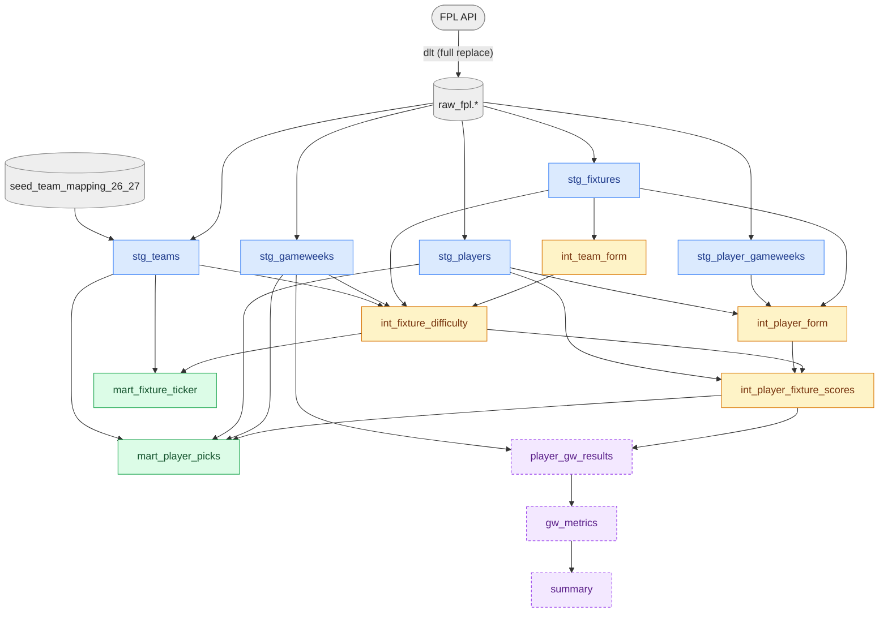

# EPL Mastermind

A portable analytics pipeline for Premier League and Fantasy Premier League data.

**Stack:** [dlt](https://dlthub.com) → [DuckDB](https://duckdb.org) → [SQLMesh](https://sqlmesh.readthedocs.io)

## What It Does

Pulls data from two APIs and builds analytical models for FPL decision-making:

- **Who should I captain?** — Player form × fixture difficulty
- **Where are the differentials?** — High-form, low-ownership picks
- **Which teams have easy runs?** — Next 8 fixtures per team, with average FDR over the next 3 and 5
- **Does the scoring model work?** Backtests the player-scoring model against historical gameweek results

## Data Sources

| Source | What | Auth |
|---|---|---|
| [FPL API](https://fantasy.premierleague.com/api/bootstrap-static/) | Players, teams, fixtures, gameweeks | None (public) |
| [football-data.org](https://www.football-data.org/) | Match results, standings, scorers (ingested, not yet modeled) | Free API key |

## Quickstart

```bash
# 1. Clone and install
git clone https://github.com/zpollats/epl_mastermind_v2.git
cd epl_mastermind_v2
uv sync

# 2. Configure
cp .env.example .env
# Adding your football-data.org API key to .env is optional for running

# 3. Run the full pipeline
make run
```

## Project Structure

```
epl_mastermind_v2/
├── dlt/                        # Ingestion pipelines
│   ├── fpl_pipeline.py         # FPL API → DuckDB
│   └── football_data_pipeline.py  # football-data.org → DuckDB
├── sqlmesh/                    # Transformation layer
│   ├── config.yaml
│   ├── external_models.yaml
│   ├── seeds/                  # Static reference data (team mappings for 26/27 season)
│   ├── audits/
│   ├── tests/  
│   └── models/
│       ├── staging/            # Clean & type-cast raw data
│       ├── intermediate/       # Team performance, fixture difficulty, scoring
│       ├── marts/              # Final serving models
│       └── backtest/           # Model evaluation (isolated env)
├── data/                       # Local DuckDB database (gitignored)
├── Makefile                    # Common commands
└── pyproject.toml              # Dependencies (managed by uv)
```

## Make Commands

| Command | What |
|---|---|
| `make sync` | Install dependencies |
| `make ingest-fpl` | Pull FPL API data |
| `make ingest-fd` | Pull football-data.org data |
| `make ingest-history` | Pull FPL player history data |
| `make ingest` | Run both FPL ingestion pipelines (fpl and history) |
| `make plan-dev` | Plan & run SQLMesh models in dev |
| `make refresh-dev` | Rerun mart generation in dev environment |
| `make plan` | Deploy model changes to prod, then refresh data |
| `make run` | Full pipeline: ingest data + plan prod |
| `make backtest` | Run backtest models for validation |
| `make test` | Run SQLMesh tests |
| `make ui` | Launch SQLMesh browser UI |
| `make clean` | Delete local data files |

## Model Lineage



**Legend:** blue = staging · amber = intermediate (audited: grain, not_null, point-in-time) · green = marts (prod) · dashed purple = backtest (isolated `backtest` env, built only by `make backtest`)

## Design Decisions

- **dlt** handles schema inference and JSON normalization, and can swap destinations without changing extraction code
- **SQLMesh** over dbt: plan/apply shows breaking versus non-breaking changes before anything runs, dev environments are virtual (no recompute), and unit tests and audits are built in.
- **DuckDB**: data is small (MBs), so an in-process columnar engine beats running a server, and it reads Parquet on S3 directly when project moves to cloud.
- ASOF enforces strict point-in-time features using the gameweek deadline; only look at data from the most recent finished fixture prior to the deadline. This strcuture ensures accuracy during double gameweeks and blanks.
- Audits for ASOF columsn to ensure no data leakage with future information making its way into current fixtures plus a unit test with a sentinel value proving a fixture’s own result never reaches its features.
- Backtests are separated because production must never depend on analysis. Both share one scoring path, so the backtest measures what actually ships.
  - Backtest, GW4–9 (90 picks, 15 per gameweek by squad size): the model averaged 4.39 pts/pick vs 4.88 for the most-owned players at each position and 2.18 for the average eligible player. Within-position Spearman ρ ≈ 0.38. The model clearly beats the field but does not yet beat the crowd.

## Roadmap

- [x] **Phase 1:** Core pipeline: dlt + SQLMesh + DuckDB, run locally; SQLMesh tests and audits for data quality
- [ ] **Phase 2:** Containerize: Docker image that runs the full pipeline
- [ ] **Phase 3:** AWS deployment: S3 storage, least-privilege IAM, all provisioned with Terraform
- [ ] **Phase 4:** Scheduled runs on ECS Fargate via EventBridge; CloudWatch alerts; CI/CD with GitHub Actions (OIDC)
- [ ] **Phase 5:** Star schema in S3, queried with Athena
- [ ] **Phase 6:** Later: public dashboard; ML-based scoring model
